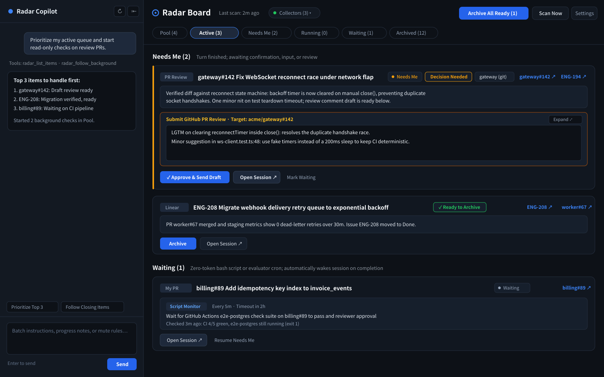

English | [简体中文](./README.zh-CN.md)

# Paseo Radar

Radar brings issues, review requests and messages into a single Paseo board. Start a read-only background check from a card, open a coding session in an isolated Git worktree, or review a draft before authorizing an external action.

## First scan

1. Install [uv](https://docs.astral.sh/uv/) on the daemon host. From a checkout run `paseo plugin install /absolute/path/to/paseo-radar` (Paseo ≥0.15.0).
2. Open **Settings → Radar**. Choose a trusted provider and configure its credentials on the host: for example, sign in to `gh` for GitHub or `glab` for GitLab. Linear and Slack seeds are also available. Bundled sources start disabled.
3. Enable the provider, run a dry check, then choose **Scan Now** on the board. Unchanged items skip model triage; shared entity keys join links from different sources.

## Provider contract

The host starts Python scripts via uv and exchanges newline-delimited JSON-RPC 2.0 over stdio. The protocol is read-only; give trusted scripts only the credentials they need. In **oneshot** mode the host initializes a process, requests sync, health or a wait check, then closes it. A **daemon** can also push incremental changes. The Python SDK (`radar_provider.py`) and seeds are installed in the plugin data directory under `providers/`; this directory takes precedence over legacy `collectors/`.

Use `providers/providers.json` for source configuration. Extend entity recognition with URL matchers, entity templates and resource labels in `domain-rules.json`. See the [protocol, SDK examples and CLI checks](./scripts/collectors/SPEC.md).

**First message (2B):** the provider supplies an item's `archetype`, `intent`, source excerpt (`context`) and short domain `hint`. Radar assembles the opening message for background preparation or immediate work; the provider need not write a full prompt for each action.

## Working with cards

Cards move from the pool into running sessions. **Needs me** distinguishes decisions and missing input from progress reviews and items ready to archive. If progress depends on an external condition, set a timeout and choose a wait mode:

| Mode | When to use it |
| --- | --- |
| `provider` | A source supports the predicate: call its read-only `provider/checkWait` without a model. |
| `script` | A scheduled read-only shell check: exit 0 = ready, **exit 10 = pending**, other codes = errors. |
| `board` | Listen for prerequisite subcards to reach the requested state; no polling script. |
| `ai` | A scheduled evaluator interprets evidence against a read-only check prompt. |

A satisfied condition or timeout wakes the owning session.

- **Coordination:** enable the beta, then use `/radar-coord on` to coordinate dependent subcards; `open` opens the inner board.
- **Goal:** `/radar-goal <goal> [--max N] [--verify <command>]` continues across turns until verified, paused for input, or bounded by the turn limit.
- **Insights:** `/radar-insights [7d|14d|30d|all] [focus]` analyzes local session and board activity to highlight repeated corrections, tool failures and completion trends.

## Settings → Radar

| Setting | Purpose |
| --- | --- |
| `autoScanEnabled` | Scan every 15 minutes (on by default). |
| `trackLocalWorkspaces` | Include ordinary local workspaces (on by default). |
| `coordinationBetaEnabled` | Enable coordination boards (off by default). |
| `timezone` | IANA time zone for cron and snooze; blank uses the host zone. |
| `assignableModels` | Models and profiles available for task assignment, with descriptions for routing. |
| `copilotModel` | Board assistant. |
| `triageModel` | Filter, group and route changed items. |
| `waitEvalModel` | Read-only AI wait checks. |
| `summaryModel` | Summarize turns and evaluate Goal progress. |
| `insightModel` | Synthesize collaboration reports. |

The five role-specific model settings accept ordered fallback lists. The settings screen also manages providers and muted keywords.

[Contributor guide](./AGENTS.md) · [MIT license](./LICENSE)
