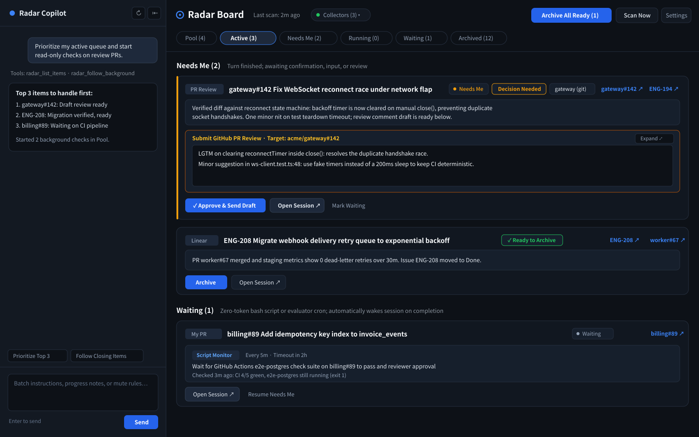

[English](./README.md) | 简体中文

# Paseo Radar

Radar 将工单、代码评审和待回复消息汇入同一块 Paseo 看板。你可以在卡片上发起后台只读预查，在独立 Git worktree 开会话处理代码，或先审阅草稿再确认外发。

## 第一次扫描

1. 在服务端安装 [uv](https://docs.astral.sh/uv/)，检出项目后运行 `paseo plugin install /absolute/path/to/paseo-radar`。需要 Paseo ≥0.15.0。
2. 打开 **Settings → Radar**。选择可信 Provider，在服务端配置凭证，例如登录 GitHub 的 `gh` 或 GitLab 的 `glab`。也内置 Linear 和 Slack，所有内置源默认关闭。
3. 启用 Provider 并试运行，再点击看板上的「立即扫描」。未变更的条目不触发模型分拣；相同实体键可将不同来源的链接归到一张卡片。

## Provider 协议

服务端通过 uv 启动 Python 脚本，在标准输入输出上逐行交换 JSON-RPC 2.0 消息。协议只提供读操作；仅安装可信脚本并授予所需的最小权限。**oneshot** 模式在初始化后同步条目、检查健康状态或检查等待条件，随后退出。**daemon** 模式常驻，还可以主动推送增量变更。插件会将 Python SDK（`radar_provider.py`）与内置脚本安装到数据目录下的 `providers/`，同名脚本优先于旧目录 `collectors/`。

在 `providers/providers.json` 配置信源；在 `domain-rules.json` 中添加 URL 匹配规则、实体模板与资源标签。接口、SDK 示例与命令行调试方法见 [Provider 规范](./scripts/collectors/SPEC.md)。

**2B 首轮消息：** Provider 提供事项类型（`archetype`）、处理意图（`intent`）、原文摘录（`context`）和简短提示（`hint`）。Radar 按后台预查或立即处理的场景组装首条消息，无需每个源分别编写完整提示词。

## 跟进卡片

待办池卡片启动会话后进入「处理中」。「待我处理」区分待确认、待补充、待查阅和可归档。需要等外部条件时设定超时上限，选择对应模式：

| 模式 | 适用情况 |
| --- | --- |
| `provider` | 信源支持原生条件，直接调用只读 `provider/checkWait`，不消耗模型 token。 |
| `script` | 定时运行只读 shell 检查：exit 0 表示达成，**exit 10 表示继续等待**，其他退出码视为异常。 |
| `board` | 监听同看板前置子卡达到指定状态，无需脚本轮询。 |
| `ai` | 独立评估模型根据只读检查指令定时判断条件。 |

条件达成或超时后，Radar 唤醒原会话。

- **协调：** 启用协调模式测试版后，用 `/radar-coord on` 分派有依赖关系的子卡；`open` 打开内层看板。
- **目标：** `/radar-goal <目标> [--max N] [--verify <验收命令>]` 跨轮次推进直到通过验收、需要人工介入或达到上限。
- **协作洞察：** `/radar-insights [7d|14d|30d|all] [重点方向]` 分析本地会话和看板记录，找出反复纠偏、工具失败与任务完结的趋势。

## Settings → Radar

| 设置 | 用途 |
| --- | --- |
| `autoScanEnabled` | 每 15 分钟扫描一次，默认开启。 |
| `trackLocalWorkspaces` | 自动纳管普通本地工作区，默认开启。 |
| `coordinationBetaEnabled` | 启用协调看板，默认关闭。 |
| `timezone` | 定时检查和暂缓使用的 IANA 时区；留空跟随服务端。 |
| `assignableModels` | 可分派的模型与配置档案；描述用于匹配任务。 |
| `copilotModel` | 看板助手。 |
| `triageModel` | 过滤、归并和分派新增或变更的事项。 |
| `waitEvalModel` | AI 等待模式的只读检查。 |
| `summaryModel` | 轮次摘要和 Goal 进度判定。 |
| `insightModel` | 汇总协作洞察报告。 |

五个内置角色的模型设置支持按顺序回退。设置页还可管理 Provider 和屏蔽关键词。

[贡献指南](./AGENTS.md) · [MIT 许可](./LICENSE)
